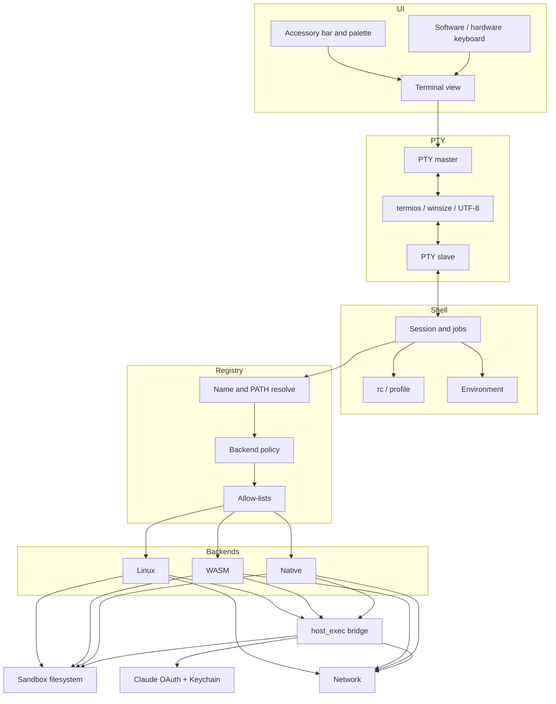
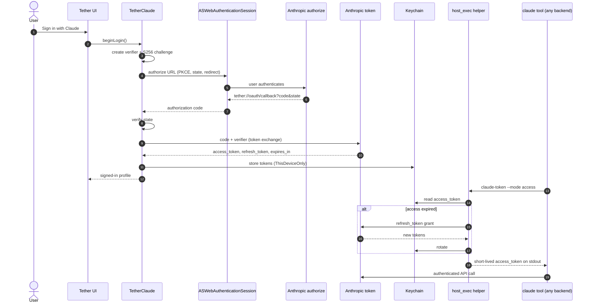

# Tether architecture

Tether is an iOS developer terminal. A session starts in the UI, is bound to a
pseudo-terminal, is driven by a shell, and resolves commands through a registry
that selects one of three execution backends: **Native**, **WASM**, or
**Linux**.

This document describes the intended runtime shape for the current development
line. Path names are the contracted layout for the product repository. If a
track's tree differs, update this file in the same change.

Related documents: [LIMITATIONS.md](LIMITATIONS.md),
[VALIDATION.md](VALIDATION.md), [RELEASES.md](RELEASES.md).

License: [CC-BY-4.0](https://creativecommons.org/licenses/by/4.0/).

---

## 1. Scope

| In scope | Out of scope |
| --- | --- |
| On-device terminal UI, PTY, shell, and command dispatch | A complete Linux kernel or hypervisor |
| Three backends: Native, WASM (interpreted), Linux (user-mode) | JIT, `MAP_JIT`, RWX pages, or runtime code generation |
| Claude OAuth (PKCE) and token use by on-device tools | Hosting Claude inference; tokens never leave the device except to Anthropic |
| `host_exec` as a mediated bridge from guest to bundled host work | Arbitrary host process spawn or unsandboxed native download |
| iOS sandbox, Keychain, and App Store–safe execution | Jailbreak, entitlements Apple will not grant to a third-party app |

Tether assumes one interactive user inside the iOS app sandbox. Guest
permissions are a compatibility mechanism, not a container boundary. See
[LIMITATIONS.md](LIMITATIONS.md).

---

## 2. System overview



Execution is a single pipeline. The UI never talks to a backend directly. The
PTY is the only byte stream the renderer consumes. The shell is the only
session that owns jobs. The registry is the only place a command name becomes
a backend choice.

```text
UI  →  PTY  →  Shell  →  Registry  →  Native | WASM | Linux
                                              │
                                              └── host_exec  →  host APIs / bundled helpers
```

---

## 3. Layers

### 3.1 Terminal UI

Owner: **P1**. Platform chrome: **I1**.

The UI is a SwiftUI surface over a Metal-backed glyph renderer. It owns:

- glyph cache, colour, underline, and cursor
- scrollback and selection
- software keyboard, hardware keyboard, and the accessory bar
- session tabs and the command palette
- theme, font, and dynamic-type settings

It does **not** parse shell syntax, spawn processes, or hold OAuth tokens. Input
is encoded as UTF-8 (plus the active keypad / function-key map) and written to
the PTY master. Output is a stream of bytes plus OSC / CSI that the renderer
interprets.

Resize is a `TIOCSWINSZ` on the PTY, never a private side channel.

### 3.2 PTY

Owner: **P2**.

The PTY is a POSIX-shaped pair:

| Side | Held by | Role |
| --- | --- | --- |
| Master | UI session object | Read output, write input, ioctl winsize |
| Slave | Shell (and children, via inheritance) | stdin / stdout / stderr, termios, job-control signals |

Responsibilities:

- line discipline and `termios` flags (`ICANON`, `ECHO`, `ISIG`, `IUTF8`)
- window size and `SIGWINCH`
- UTF-8 completeness (no torn code points delivered as a read)
- flow control (`IXON` / `IXOFF`, and a bounded master buffer)
- session leadership so `Ctrl-C` / `Ctrl-Z` reach the foreground process group

The PTY is host-side. Linux-guest programs see a Linux PTY synthesised by the
Linux backend; that guest PTY is *bridged* to the host PTY, it does not replace
it.

### 3.3 Shell

Owner: **P3**.

The default interactive shell is a POSIX-compatible login shell started against
the PTY slave. It owns:

- session lifecycle (create, attach, detach, destroy)
- job control and process groups
- `PATH`, `HOME`, `TERM`, `COLORTERM`, `LANG`
- rc / profile load order
- the working directory that the registry inherits

A session may be restored after the app returns from the background only if
the PTY and the selected backend are still alive. Background death is an iOS
lifecycle fact, not a shell bug; see [LIMITATIONS.md](LIMITATIONS.md).

### 3.4 Registry

Owner: **P4**.

The registry is the only name-resolution step between the shell and a backend.

```text
argv[0]
   │
   ├─ exact builtin?          → Native in-process handler
   ├─ host_exec allow-list?   → Native via host_exec
   ├─ WASM module map?        → WASM
   ├─ Linux $PATH hit?        → Linux
   └─ else                    → ENOENT (or a Linux miss, if the session is Linux-first)
```

Resolution policy is a table, not ad-hoc `if`s in the shell:

| Key | Meaning |
| --- | --- |
| `name` | Command basename or absolute path |
| `backend` | `native` / `wasm` / `linux` |
| `mode` | `inproc` / `host_exec` / `module` / `guest_exec` |
| `argv_policy` | Allowed switches, path rules, env subset |
| `fs_view` | Which sandbox trees the command may see |
| `net` | `none` / `https-only` / `full` |
| `timeout_ms` | Hard kill |
| `memory_hint` | Soft budget for jetsam avoidance |

A command that exists in more than one backend is disambiguated by the session
profile (`linux-first`, `native-first`, or an explicit `tether-run --backend=`).

The registry never executes. It returns a *handle*. The chosen backend executes
the handle.

### 3.5 Native backend

Owner: **P5**.

Native means “runs as ordinary iOS process code,” not “downloaded Mach-O.”

Two shapes:

1. **In-process handler** — a Swift or C function linked into the app
   (builtins, open-in-Files, clipboard, `openurl`, Claude token helper).
2. **`host_exec`** — a mediated spawn of a *bundled, signed* helper, or a
   tightly wrapped host API. See [§5](#5-host_exec-bridge).

Native is the right backend when the work is an iOS capability (Keychain,
document picker, local network permission, share sheet) or a small, audited
tool that should not pay Linux or WASM overhead.

Native is the wrong backend for general userland. That is Linux or WASM.

### 3.6 WASM backend

Owner: **P6**.

WASM modules are interpreted. There is no compiler, no `MAP_JIT`, and no
runtime-generated native code. Modules ship in the app bundle or in the
on-device module cache that only accepts a signed index.

The runtime presents a WASI-shaped preview of the sandbox filesystem and a
restricted sockets cap. Threads and shared-memory atomics are not part of the
v1 contract ([LIMITATIONS.md](LIMITATIONS.md)).

WASM is the right backend for portable tools whose source we control and whose
syscall needs are small (linters, formatters, protocol codecs, some language
CLIs).

### 3.7 Linux backend

Owner: **P7**.

Linux is a user-mode AArch64 guest with a userspace kernel: process, memory,
signals, files, sockets, and PTYs implemented inside the app process. Guest
instructions are *interpreted*. The shipped rootfs is an AArch64 Linux
userland (Alpine-class) packaged with the app.

This backend exists so developers can run a recognisable Unix userland
(`apk` / equivalent, POSIX tools, language toolchains that do not require a
real kernel) without leaving iOS and without generating executable pages.

It is not a virtual machine, not KVM, and not a container runtime. Namespaces,
cgroups, kernel modules, and Docker are out of scope.

Guest programs that need a host capability (Keychain, document picker, Claude
token, a bundled helper) do not poke the host. They call `host_exec`.

---

## 4. Claude OAuth flow

Owner: **P10**. Keychain and ASWebAuthenticationSession: **I1**.

Tether never embeds a long-lived Anthropic secret in the binary. Interactive
sign-in uses OAuth 2.0 with PKCE. Tokens live in the Keychain. Guest code
never sees the refresh token.



### 4.1 Endpoints and client shape

| Item | Contract |
| --- | --- |
| Authorize | Anthropic OAuth authorize URL registered for the Tether client |
| Token | Anthropic OAuth token URL |
| Redirect | Custom URL scheme `tether://oauth/callback` (plus an HTTPS universal-link spare if App Store review requires it) |
| Challenge | S256 PKCE; plain PKCE is rejected |
| `state` | 128-bit random, single use, 10-minute TTL |
| Scopes | The minimum set needed for the on-device Claude tool (identity + inference). No offline-unrelated scopes. |
| Client type | Public native client. No client secret in the app. |

Exact URLs, client id, and scope strings live in the P10 package configuration,
not in this document. Rotate them without a doc rewrite; keep the *flow* here.

### 4.2 Token storage

| Field | Storage | Accessibility |
| --- | --- | --- |
| `access_token` | Keychain | `AfterFirstUnlockThisDeviceOnly` |
| `refresh_token` | Keychain | `AfterFirstUnlockThisDeviceOnly` |
| `expires_at` | Keychain (same item) | same |
| `account_id` / display name | Keychain + optional UserDefaults display copy | display copy is non-secret |

Tokens are not written to the Linux rootfs, the WASM preopens, iCloud, or
analytics. Screenshot / backup exclusion is set on the Keychain item.

Sign-out deletes the item and revokes at the token endpoint when the IdP
supports revocation.

### 4.3 How tools obtain a token

The only supported read path is the Native `claude-token` helper via
`host_exec`:

```text
host_exec  claude-token  --mode access
```

- stdout: the access token and a trailing newline, or nothing on failure
- stderr: a stable error token (`not-signed-in`, `locked`, `revoked`, `network`)
- exit: `0` on success, non-zero otherwise

The helper refuses to run if the caller is not the Tether registry (code
signature of the requesting backend context). Linux and WASM therefore call it
as a `host_exec` command, never by opening the Keychain themselves.

### 4.4 Failure modes the UI must handle

| Symptom | User-visible | Next step |
| --- | --- | --- |
| User cancels ASWebAuthenticationSession | “Sign-in cancelled” | Idle |
| `state` mismatch | “Sign-in failed” | Restart login; do not retry the same state |
| Token exchange 4xx | “Sign-in rejected” | Restart login |
| Refresh 401 | Session ended | Force interactive login |
| Device locked, Keychain gated | “Unlock the device to use Claude” | Wait for unlock |
| No network | “Claude is offline” | Do not clear tokens |

---

## 5. host_exec bridge

Owner: **P5**. Policy review: **I1**. Callers: **P6**, **P7**, **P10**.

`host_exec` is the only way a WASM or Linux guest reaches a host capability.
It is not `system(3)` and it is not a general POSIX `exec`.

```text
guest / in-process caller
        │
        v
registry (name must already resolve to mode=host_exec)
        │
        v
host_exec broker
        │  validate: allow-list, argv, cwd, env, fds, budget
        │
        ├─ in-process handler   (same address space, no spawn)
        └─ bundled helper       (posix_spawn of a signed Mach-O in the app bundle)
                │
                v
           pipes back to caller (stdout / stderr / exit)
```

### 5.1 Request

A request is a structured record, not a shell line:

| Field | Rule |
| --- | --- |
| `name` | Basename on the allow-list. No `/` in `name`. |
| `argv` | Array. No implicit `sh -c`. |
| `env` | Explicit allow-list (`TERM`, `LANG`, `HOME` *inside the sandbox*, request id). No `DYLD_*`, no `PATH` mutation. |
| `cwd` | Must resolve inside the sandbox view declared for that command. |
| `stdin` | Bytes or a PTY/pipe the broker already owns. |
| `stdout` / `stderr` | Pipes created by the broker. |
| `timeout_ms` | Required. Broker kills on expiry. |
| `max_output_bytes` | Required. Excess is truncated and the process is killed. |

### 5.2 Allow-list (initial)

The v1 allow-list is short on purpose. Adding a name is a P5 change that
needs an I1 security note in the same PR.

| name | Kind | Purpose |
| --- | --- | --- |
| `claude-token` | in-process | Issue a short-lived access token |
| `claude-logout` | in-process | Delete Keychain item + revoke |
| `openurl` | in-process | `SFSafariViewController` / `UIApplication.open` |
| `share` | in-process | Share sheet for a sandbox file |
| `pbcopy` / `pbpaste` | in-process | Pasteboard, size-capped |
| `files-pick` | in-process | Document picker → security-scoped bookmark |
| `files-reveal` | in-process | Reveal a sandbox URL in Files |
| `notify` | in-process | Local notification (user-permissioned) |
| `tether-helper` | bundled Mach-O | Small signed helper for work that must not live in-process |

There is no `sh`, `bash`, `ssh-keygen -A`, or arbitrary `xcrun` on this list.

### 5.3 Trust boundary

- The broker runs in the app process. A compromised guest can *request*
  anything; the broker must assume argv is hostile.
- Path arguments are resolved and checked after symlink expansion against the
  command's `fs_view`.
- Helpers are launched with a clean Mach task, no inherited privileged XPC,
  and a sandbox profile no wider than the app's.
- Exit status, not exception, is the only result. A crashed helper is
  `ECHILD` / a dedicated status, never an in-process abort.
- Every invocation is logged to an on-device ring (name, cwd, duration, exit)
  without capturing token bytes or file contents.

---

## 6. Filesystem and network

Owners: **P8** (fs), **P9** (net). Sandbox rules: **I1**.

### 6.1 Views

| View | Backing | Seen by |
| --- | --- | --- |
| App container | `Documents/`, `Library/`, `tmp/` | All backends |
| Linux rootfs | Packaged AArch64 userland + writable overlay | Linux only |
| WASM preopens | Explicit directory caps | WASM only |
| Security-scoped bookmarks | User-picked Files locations | Native + `host_exec` consumers that asked |
| iCloud / ubiquity | Optional, off by default | Native, if the user enabled it |

Linux fakefs-style metadata (uid/gid/mode) is a compatibility overlay. It
does not create a second security domain.

### 6.2 Network

| Class | Default |
| --- | --- |
| Native | `NSURLSession` / Network.framework, ATS on |
| WASM | Explicit cap; deny by default |
| Linux | Userspace sockets mapped to host TCP/UDP; no raw sockets, no packet filters |
| Local network | Requires the user's Local Network permission |
| SSH | Client-only, keys in the Keychain or a user-picked file, never auto-generated into a world-readable guest path |

---

## 7. Session lifecycle

```text
launch
  │
  ├─ restore bookmarks, Keychain presence (not token values), theme
  ├─ create PTY
  ├─ start shell against slave
  └─ first prompt

foreground  ↔  background
  │
  ├─ short background: PTY stays up, timers coalesced
  └─ jetsam / expiry: session is dead; UI offers restore (new PTY, same cwd if possible)

terminate
  ├─ hangup the PTY
  ├─ registry cancels in-flight host_exec
  └─ Linux / WASM worlds are torn down; overlay is flushed
```

State that must survive a jetsam: theme, font, tab list, last cwd, Claude
signed-in *flag*, security-scoped bookmarks. State that must not be required
to survive: live process trees, PTY scrollback beyond the persisted cap,
in-memory Linux mappings.

---

## 8. iOS application boundary

Owner: **I1**. Signing and upload: **I3**. URL handler: **P10**.

The `Apps/Tether` target is the only product that produces a bundle. Packages
are libraries. The app is the trust boundary Apple reviews.

| Seam | Contract |
| --- | --- |
| Bundle | One `CFBundleIdentifier` for TestFlight and App Store. Debug may share it; it must not silently switch Keychain groups. |
| Entitlements | Keychain access group, `tether://` URL scheme, optional associated-domains spare for OAuth, Local Network usage string. **No** `com.apple.developer.cs.allow-jit`, **no** `dynamic-codesigning`, **no** VoIP. |
| URL handler | `tether://oauth/callback` is owned by `TetherClaude` via the scene / app delegate. Unknown hosts on the scheme are ignored. |
| Rootfs | Packaged AArch64 userland stamped at build time. `Apps/Tether/Resources/` holds the stamp; `Rootfs/` holds the fetch script. A rootfs for another architecture is a build failure. |
| WASM index | Signed module list shipped in the bundle. Load rejects anything not on the index. |
| Helpers | Only Mach-O files under `Helpers/`, signed with the same team as the app, may be `posix_spawn`'d by `host_exec`. |
| Background | No unbounded assertion. The OS may jetsam. See [LIMITATIONS.md](LIMITATIONS.md) L-IOS-01 / L-SH-01. |
| Signing | Development, TestFlight, and App Store profiles are I3's matrix. A capability that works in Xcode is not proven until the *archive* is installed. |

The iOS sandbox is the only real isolation from the rest of the device. Guest
uid/gid, WASM rights, and the `host_exec` allow-list sit *inside* that
sandbox. They are policy, not a second kernel.

Linux-host fixtures (P7) never establish this boundary. Device gates in
[VALIDATION.md](VALIDATION.md) do.

---

## 9. Repo folder map

This is the contracted tree. Tracks own the directories named in the
right-hand column. Generated folders (`build/`, `.build/`, `DerivedData/`,
`node_modules/`) are not source.

```text
tether/
├── Apps/
│   └── Tether/                     I1  iOS app target, Info.plist, entitlements
│       ├── Resources/              I1  assets, default theme, rootfs stamp
│       └── Support/                I1  app delegate, scene, URL handlers
├── Packages/
│   ├── TetherUI/                   P1  terminal view, keyboard, themes
│   ├── TetherPTY/                  P2  PTY master/slave, termios
│   ├── TetherShell/                P3  session, jobs, rc
│   ├── TetherRegistry/             P4  resolve + policy tables
│   ├── TetherNative/               P5  in-process handlers, host_exec broker
│   ├── TetherWASM/                 P6  interpreter, WASI caps, module index
│   ├── TetherLinux/                P7  userspace kernel, guest interpreter, rootfs glue
│   ├── TetherFS/                   P8  sandbox views, bookmarks, overlays
│   ├── TetherNet/                  P9  sockets, ATS, SSH client
│   └── TetherClaude/               P10 OAuth, Keychain, claude-token helper
├── Rootfs/                         P7  packaged Linux userland + fetch script
├── Modules/                        P6  shipped WASM modules + signed index
├── Helpers/                        P5  bundled signed Mach-O helpers
├── Scripts/
│   ├── validate-sim.sh             I2  simulator gate
│   ├── validate-device.sh          I2  device gate
│   └── bump-version.sh             I3  MARKETING_VERSION + build
├── fastlane/                       I3  TestFlight / App Store lanes
├── Tests/                          I2  unit, PTY, registry, OAuth mocks
├── docs/                           P11 this documentation set
│   ├── ARCHITECTURE.md
│   ├── LIMITATIONS.md
│   ├── VALIDATION.md
│   ├── RELEASES.md
│   └── HANDOFF.md
└── LICENSE
```

Xcode: one workspace, one app target (`Tether`), one TestFlight configuration,
shared schemes documented in [VALIDATION.md](VALIDATION.md). Package products
are libraries; only `Apps/Tether` produces a bundle.

---

## 10. Track ownership

Tracks run from **P1** through **I3**. P11 is documentation only.

| Track | Name | Owns |
| --- | --- | --- |
| P1 | Terminal UI | Rendering, input chrome, themes |
| P2 | PTY | Pseudo-terminal, termios, winsize |
| P3 | Shell | Sessions, jobs, environment |
| P4 | Registry | Name resolution, backend policy |
| P5 | Native | In-process tools, `host_exec` |
| P6 | WASM | Interpreter, WASI, module index |
| P7 | Linux | Userspace kernel, guest, rootfs |
| P8 | Filesystem | Views, bookmarks, overlays |
| P9 | Network | Sockets, ATS, SSH client |
| P10 | Claude | OAuth, Keychain, token helper |
| P11 | Documentation | These files, structure, drift |
| I1 | iOS platform | Entitlements, sandbox, lifecycle, a11y |
| I2 | Validation | Simulator / device gates, fixtures |
| I3 | Release | Versions, signing, TestFlight, review |

A change that crosses a boundary updates this file and
[LIMITATIONS.md](LIMITATIONS.md) in the same PR.

---

## 11. Trust and process model

Tether is one iOS process (plus short-lived bundled helpers). Isolation
between Native, WASM, and Linux is cooperative and policy-based:

- WASM cannot address Native memory except through WASI and `host_exec`.
- Linux guest memory is emulator-owned data. It is not a hardened VM.
- Native handlers run in-process and must treat every argument as hostile.
- The iOS sandbox is the only real security boundary against the rest of the
  device.

Do not describe Tether as a container, a jail, or a safe place to run untrusted
binaries. It is a developer terminal for the device owner.

---

## 12. What this document is not

- It is not a syscall catalogue (P7 owns that list next to the kernel table).
- It is not an App Review essay (the review *note* lives in
  [RELEASES.md](RELEASES.md)).
- It is not a promise that every box in the diagrams has shipped. Status of
  each gap is in [LIMITATIONS.md](LIMITATIONS.md).
